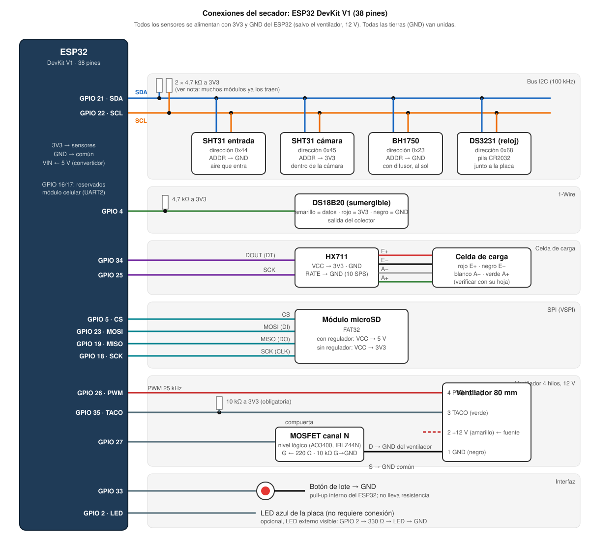

# Manual de conexiones del prototipo

Cómo conectar los sensores, la microSD, el ventilador y la alimentación al **ESP32 DevKit V1 (38 pines)**. Los pines son los del firmware (`firmware/include/config.h` y §3 del documento de diseño): **si cambia un pin aquí, hay que cambiarlo también en el código.**



---

## 1. Lista de materiales

| Cant. | Componente | Notas |
|---|---|---|
| 1 | ESP32 DevKit V1, 38 pines | Con cable USB **de datos** |
| 2 | SHT31 (módulo, ej. Adafruit o GY-SHT31-D) | Temperatura y HR: uno a la entrada de aire y otro en la cámara |
| 1 | DS18B20 sumergible (con cable) | Temperatura a la salida del colector, hasta 125 °C |
| 1 | BH1750 (módulo GY-302) | Luz; con difusor (§8.2 del documento) |
| 1 | DS3231 (módulo ZS-042 o similar) + pila CR2032 | Reloj. Ver la nota de la pila en 4.4 |
| 1 | HX711 (módulo verde) | Amplificador de la celda |
| 1 | Celda de carga de barra, 10 kg | La bandeja piloto con producto pesa hasta unos 7 kg |
| 1 | Módulo microSD (SPI) + tarjeta de 4 a 32 GB | Formateada en **FAT32** |
| 1 | Ventilador de **4 hilos**, 80 mm, 12 V (PWM) | De 3 hilos **no** sirve: no tiene entrada PWM |
| 1 | MOSFET canal N de **nivel lógico** (AO3400, IRLZ44N o IRLB8721) | Apaga del todo el ventilador. El IRFZ44N (sin "L") **no** sirve con 3,3 V |
| 1 | Pulsador normalmente abierto (para panel) | Botón de lote |
| 1 | Convertidor reductor (buck) 12 V → 5 V, ≥ 1 A (LM2596 o MP1584) | Alimenta el ESP32 |
| 1 | Fuente o batería de 12 V | Más el regulador de carga solar, si es con panel |
| 3 | Resistencias de **4,7 kΩ** | Pull-ups de I2C (2) y 1-Wire (1). Ver 4.1 |
| 3 | Resistencias de **10 kΩ** | Pull-up del tacómetro; pull-down de la compuerta del MOSFET |
| 1 | Resistencia de **220 Ω** | Serie a la compuerta del MOSFET |
| 1 | Fusible de 2 A con portafusible | En la línea de 12 V |
| — | Cable par trenzado o apantallado (UTP sirve), borneras, caja estanca, prensaestopas | Para los sensores alejados de la caja |

---

## 2. Alimentación

```
 Batería / fuente 12 V ──[fusible 2 A]──┬──────────────────────► Ventilador pin 2 (+12 V, amarillo)
                                        │
                                        └──► Buck 12 V → 5 V ──► ESP32 VIN (5 V)
                                                                   │
                                                 ESP32 3V3 ────────┴──► todos los sensores (VCC)

 GND de la batería ═ GND del buck ═ GND del ESP32 ═ GND de los sensores ═ Source del MOSFET   (todo unido)
```

- **Ajuste el buck a 5,0 V con un multímetro ANTES de conectar el ESP32.** Los módulos LM2596 vienen ajustados a cualquier valor, y 12 V en VIN quema la placa.
- Todos los sensores van a **3V3** (no a 5 V): los pines del ESP32 no toleran 5 V. La única excepción es el módulo microSD **con regulador**; ver 4.5.
- El regulador de 3,3 V de la placa entrega de sobra para todos los sensores (unos 150 mA en total).
- Mientras se prueba en mesa, el ESP32 puede alimentarse solo por USB. El ventilador necesita los 12 V aparte, **con la GND unida a la del ESP32**.

---

## 3. Tabla de conexiones

| Componente | Pin del módulo | → ESP32 | Notas |
|---|---|---|---|
| **Bus I2C** (todos en paralelo) | SDA | **GPIO 21** | 4,7 kΩ de SDA a 3V3 (ver 4.1) |
| | SCL | **GPIO 22** | 4,7 kΩ de SCL a 3V3 |
| | VCC / VIN | 3V3 | |
| | GND | GND | |
| SHT31 entrada | ADDR / AD | **GND** | Dirección 0x44 |
| SHT31 cámara | ADDR / AD | **3V3** | Dirección 0x45. Si los dos quedan en 0x44, no se distinguen |
| BH1750 | ADDR | GND (o suelto) | Dirección 0x23 |
| DS3231 | — | — | Dirección 0x68. Los pines SQW y 32K quedan sueltos |
| **DS18B20** | Amarillo (datos) | **GPIO 4** | 4,7 kΩ de datos a 3V3 |
| | Rojo | 3V3 | |
| | Negro | GND | |
| **HX711** | DT / DOUT | **GPIO 34** | Pin solo de entrada; no necesita pull-up |
| | SCK / CLK | **GPIO 25** | |
| | VCC | 3V3 | |
| | GND | GND | |
| | RATE (si lo tiene) | GND | 10 lecturas/s, como espera el firmware |
| Celda → HX711 | Rojo / Negro / Blanco / Verde | E+ / E− / A− / A+ | Colores habituales: **confirmar con la hoja de la celda**. Si la masa sale negativa, intercambie A+ y A− |
| **microSD** | CS | **GPIO 5** | |
| | MOSI / DI | **GPIO 23** | |
| | MISO / DO | **GPIO 19** | |
| | SCK / CLK | **GPIO 18** | |
| | VCC | 5 V **o** 3V3 | Según el módulo; ver 4.5 |
| | GND | GND | |
| **Ventilador** (4 hilos) | Pin 4, PWM (azul) | **GPIO 26** | PWM de 25 kHz |
| | Pin 3, TACO (verde) | **GPIO 35** | **10 kΩ de GPIO 35 a 3V3, obligatoria** |
| | Pin 2, +12 V (amarillo) | +12 V de la fuente | |
| | Pin 1, GND (negro) | **Drain del MOSFET** | El MOSFET corta la tierra (lado bajo) |
| **MOSFET** | Gate | **GPIO 27** a través de 220 Ω | Más 10 kΩ de gate a GND: el ventilador queda apagado mientras el ESP32 arranca |
| | Source | GND común | |
| **Botón** | Un terminal | **GPIO 33** | Pull-up interno: no lleva resistencia |
| | Otro terminal | GND | |
| LED de estado | — | GPIO 2 | Es el LED azul de la placa. Opcional, uno externo: GPIO 2 → 330 Ω → LED → GND |
| Reservados | — | GPIO 16 / 17 | UART2 para un futuro módulo celular. No usar |

Los colores del ventilador son los del estándar de PC (Intel). Algunos fabricantes usan otros: guíese por **la posición del pin en el conector**. El pin 1 es el del borde con la muesca o el chaflán.

---

## 4. Detalles que suelen fallar

### 4.1 Resistencias pull-up del I2C

El bus I2C necesita **una** resistencia de SDA a 3V3 y **una** de SCL a 3V3. Muchos módulos ya las traen soldadas: Adafruit SHT31 (10 kΩ), GY-302/BH1750 (4,7 kΩ) y DS3231 ZS-042 (4,7 kΩ). Al conectar varios módulos, sus resistencias quedan en paralelo.

- Si los módulos que compraron **ya tienen** pull-ups, **no agregue** las de 4,7 kΩ externas.
- Si el monitor serie muestra fallas intermitentes de los SHT31 o del BH1750 (`flags` distinto de `0x00`), mida con el multímetro la resistencia entre SDA y 3V3 **con todo apagado**. Lo bueno es entre 1,5 y 5 kΩ. Si da menos de 1 kΩ, quite pull-ups de algún módulo. Si es infinita, faltan.

### 4.2 Cables largos (sensores de cámara y colector)

El I2C está pensado para distancias cortas. El firmware ya usa 100 kHz para ayudar, pero:
- Mantenga el cable al **SHT31 de la cámara** y al **BH1750** en **2 m o menos**.
- Use **par trenzado**: SDA trenzado con GND, y SCL trenzado con 3V3. Un cable UTP de red sirve.
- Si hace falta más distancia, use un extensor de bus I2C (P82B715) o acerque la caja de electrónica.
- El **DS18B20** (1-Wire) tolera bien cables de 5 a 10 m.

### 4.3 Dónde va cada sensor

| Sensor | Ubicación | Cuidado |
|---|---|---|
| SHT31 entrada | Toma de aire del colector, a la sombra | Que no le dé el sol directo |
| SHT31 cámara | Dentro de la cámara, a la altura de la bandeja, sin tocar el producto | Use un módulo con filtro o protéjalo del goteo; soporta hasta 90 °C |
| DS18B20 | Salida del colector (aire caliente) | Llega a más de 100 °C sin flujo: use la versión sumergible |
| BH1750 | En el plano del colector, con el difusor | No tapar ni sombrear |
| Celda de carga | Bajo la bandeja piloto, en la cámara | Montaje firme, sin roce lateral; el cable sale por un prensaestopas |
| ESP32, HX711, microSD, DS3231 | **Caja estanca fuera de la cámara**, a la sombra | Dentro de la cámara superaría los 60 °C |

### 4.4 Módulo DS3231 ZS-042 y la pila

El ZS-042 trae un circuito que **carga** la pila, pensado para pilas recargables LIR2032. Con una **CR2032 común** (no recargable), ese circuito la puede hinchar. Hay dos opciones:
- Quitar con el soldador la **resistencia de 200 Ω** (o el diodo) junto al portapila.
- Usar una pila LIR2032.

Sin pila, el reloj pierde la hora en cada corte de luz. El firmware la recupera por internet (NTP) cuando hay red; mientras tanto, los registros salen con `ts: null` y el servidor les pone la hora de llegada.

### 4.5 Módulo microSD

- **Con regulador** (tiene un integrado AMS1117 de 3 patas): VCC a **5 V** (VIN del ESP32), porque con 3,3 V no funciona.
- **Sin regulador** (solo el zócalo y resistencias): VCC a **3V3**.
- Formatee la tarjeta en **FAT32**: en Windows, tarjetas de hasta 32 GB; en macOS, *Utilidad de Discos → MS-DOS (FAT)*.

### 4.6 Pines del ESP32 que no conviene tocar

- **GPIO 34 y 35** son solo de entrada y no tienen pull-up interno. Por eso el tacómetro necesita la de 10 kΩ externa.
- **GPIO 2 y 5** se leen al arrancar. Con el LED y el CS de la microSD no hay problema, pero no les ponga otras cosas.
- **GPIO 6 a 11** están conectados a la memoria flash: no los use.
- Si la placa **no carga el programa** con todo conectado, desconecte el GPIO 2 y reintente. Si así funciona, mantenga presionado el botón BOOT al cargar.

### 4.7 Ventilador

- Con PWM al 0 %, un ventilador de 4 hilos **sigue girando** despacio. Por eso existe el MOSFET: el firmware lo usa para apagarlo del todo en espera, en pausa y de noche.
- La entrada PWM del ventilador acepta la señal de 3,3 V del ESP32 en la mayoría de los modelos. Si el ventilador **no cambia de velocidad** al variar el duty, hace falta un transistor de colector abierto en la señal. Avise antes de modificarlo, porque invierte la señal y requiere un cambio en el firmware.

---

## 5. Armado paso a paso (recomendado)

Conecte **de a un bloque** y compruebe con la consola antes de seguir. El firmware funciona aunque falten sensores: los que faltan salen como `nan` y avisan con `error_sensor`.

1. **Solo el ESP32 por USB.** Cargue el firmware (`firmware/MANUAL.md`, sección 5). En el monitor serie debe aparecer `secador SEC-01 fw 1.1.0`. Escriba `estado`.
2. **Bus I2C**: SHT31 de entrada → `estado`. Debe dar `t_ent` y `hr_ent` razonables. Después agregue el SHT31 de la cámara (con ADDR a 3V3), el BH1750 y el DS3231, comprobando cada uno.
3. **DS18B20** → `t_col` cercano a la temperatura ambiente. Si da `nan`, falta la resistencia de 4,7 kΩ.
4. **HX711 y celda** → `estado` muestra `cuentas`. Si están quietas y cambian al apoyar la mano, funciona. Luego calibre (`firmware/MANUAL.md`, sección 6.2).
5. **microSD** → reinicie. Si no aparece `[evento] … error_sd`, está bien. Al iniciar un lote de prueba debe crearse el archivo `/lotes/L-xx.jsonl`.
6. **Ventilador, MOSFET y 12 V** (con las GND unidas). Inicie un lote de prueba con una masa sobre la bandeja: el ventilador debe arrancar al 30 % y `estado` debe mostrar `rpm` mayor que 400. Si `rpm` es 0 con el ventilador girando, falta la resistencia de 10 kΩ del tacómetro.
7. **Botón y LED**: pulsación corta en espera → el LED parpadea lento.
8. Pase a la **caja estanca** y a la alimentación de 12 V con el buck ya ajustado a 5 V.

### Diagnóstico rápido con `estado`

`flags` indica qué sensor falló en la última lectura (se suman):

| Valor | Sensor |
|---|---|
| 0x01 | SHT31 cámara |
| 0x02 | SHT31 entrada |
| 0x04 | DS18B20 |
| 0x08 | BH1750 |
| 0x10 | HX711 |
| 0x20 | BH1750 saturado (demasiada luz: revise el difusor) |

Por ejemplo, `flags 0x05` = SHT31 de la cámara + DS18B20.
